# PCM — Plateforme citoyenne de mobilisation

[](https://github.com/mahamoud-diabate/PCM-Connect/actions/workflows/ci.yml)


> **De l'idée au projet de quartier, en trois minutes.**
> Prototype complet (React + Vite · Node.js + Express) réalisé en 48 heures lors du **Hackathon Saint-Roch 2026** (Ville de Québec) pour répondre au défi : *« Comment faciliter la création de projets dans Saint-Roch en mobilisant les parties prenantes ? »*
>
> **Contexte hackathon :** projet présenté au jury (non primé), publié ici comme pièce de portfolio technique avec son jeu de démonstration synthétique, ses 7 tests automatisés, ses captures d'écran bureau/mobile et un [retour d'expérience détaillé sur l'architecture et les limites du prototype](docs/HACKATHON.md).

---

## Aperçu en direct (parcours complet)


- **Vidéo haute définition (MP4, 60 s, 1280×720)** : [`docs/demo-parcours.mp4`](docs/demo-parcours.mp4)
- **Support de présentation au jury (PDF, 14 diapositives)** : [`docs/presentation/PCM-presentation-jury.pdf`](docs/presentation/PCM-presentation-jury.pdf)
- **Retour d'expérience & post-mortem technique** : [`docs/HACKATHON.md`](docs/HACKATHON.md)
- **Plan d'action & FAQ du jury** : [`PLAN-ACTION.md`](PLAN-ACTION.md)

---

## Le problème et la réponse apportée par PCM

Dans le quartier Saint-Roch à Québec, une idée citoyenne ou commerciale meurt souvent faute de savoir à qui parler. Le **311** permet de signaler un irritant municipal, mais il ne connecte ni les voisins, ni les commerçants, ni les organismes communautaires.

Lorsqu'un citoyen, un commerçant ou un organisme décrit son idée en quelques mots, **PCM** croise les données du quartier et lui propose immédiatement :

- **QUI** : les organismes, commerces et entreprises pertinents, avec **l'explication claire de chaque suggestion** (domaine d'action, ressources pouvant être offertes, distance à pied, appartenance à la SDC) ;
- **OÙ** : des lieux concrets où agir sur la carte du quartier (îlots de chaleur, parcs, placettes, locaux vacants) ;
- **QUAND** : des événements à venir dans Saint-Roch auxquels greffer le lancement du projet.

Une fois les partenaires invités, le projet dispose de sa propre page collaborative :
- **Messages d'invitation personnalisés** rédigés automatiquement pour chaque partenaire et suivi des réponses (*Invité* → *Accepte* avec attribution du badge **Bâtisseur de quartier**) ;
- **Coups de main** : liste de tâches concrètes où citoyens, commerçants et organismes s'inscrivent sans créer de compte, faisant progresser la jauge de préparation avant le jour J ;
- **Offres partenaires** : catalogue des ressources mises à disposition (local, matériel, bénévoles), reliées automatiquement aux projets qui en expriment le besoin ;
- **Pouls du quartier** : tableau de bord destiné à la Ville de Québec et à la SDC Saint-Roch pour visualiser les maillages créés, les besoins non couverts et la contribution au *Plan d'action 2026-2029*.

---

## Galerie des écrans (Bureau & Mobile)

### Interface Bureau (`1440×900`)

| 1. Accueil & projets actifs | 2. Dépôt d'une idée (`/idee`) | 3. Constellation — Onglet *Qui* |
| :---: | :---: | :---: |
| 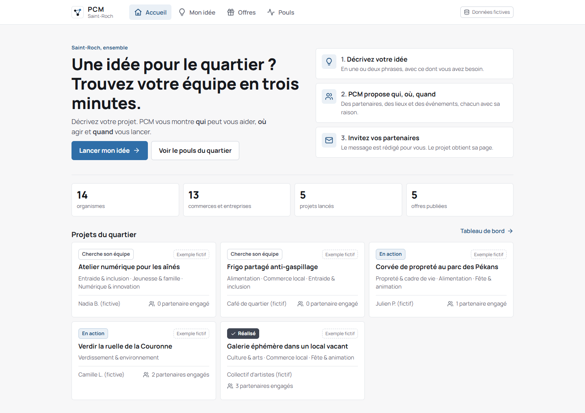 | 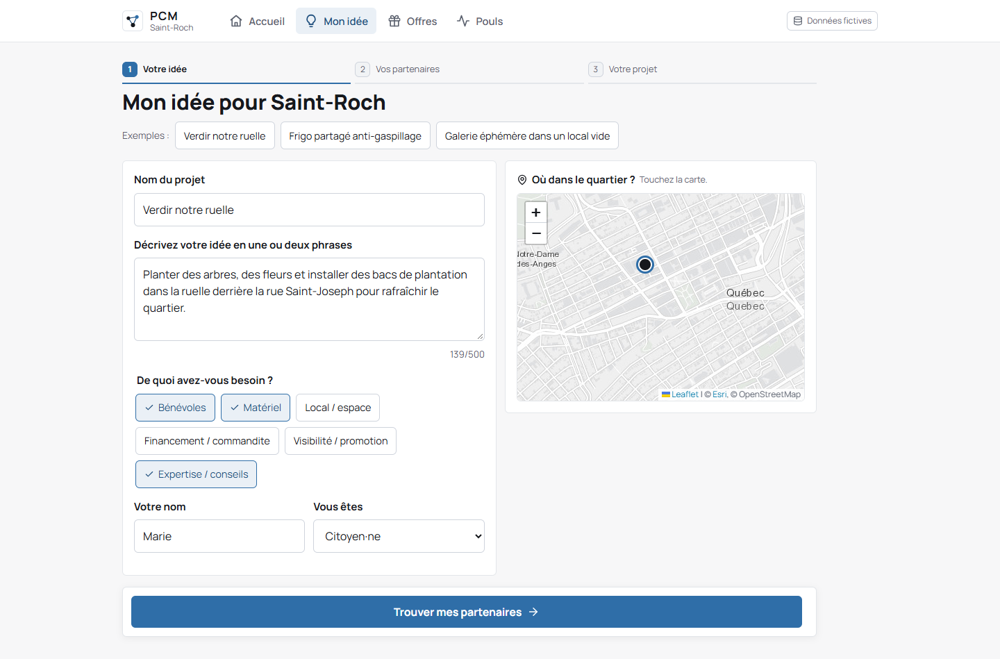 |  |
| **4. Constellation — Onglet *Où* (Carte)** | **5. Page Projet & invitations** | **6. Partenaire accepté & message auto** |
|  | 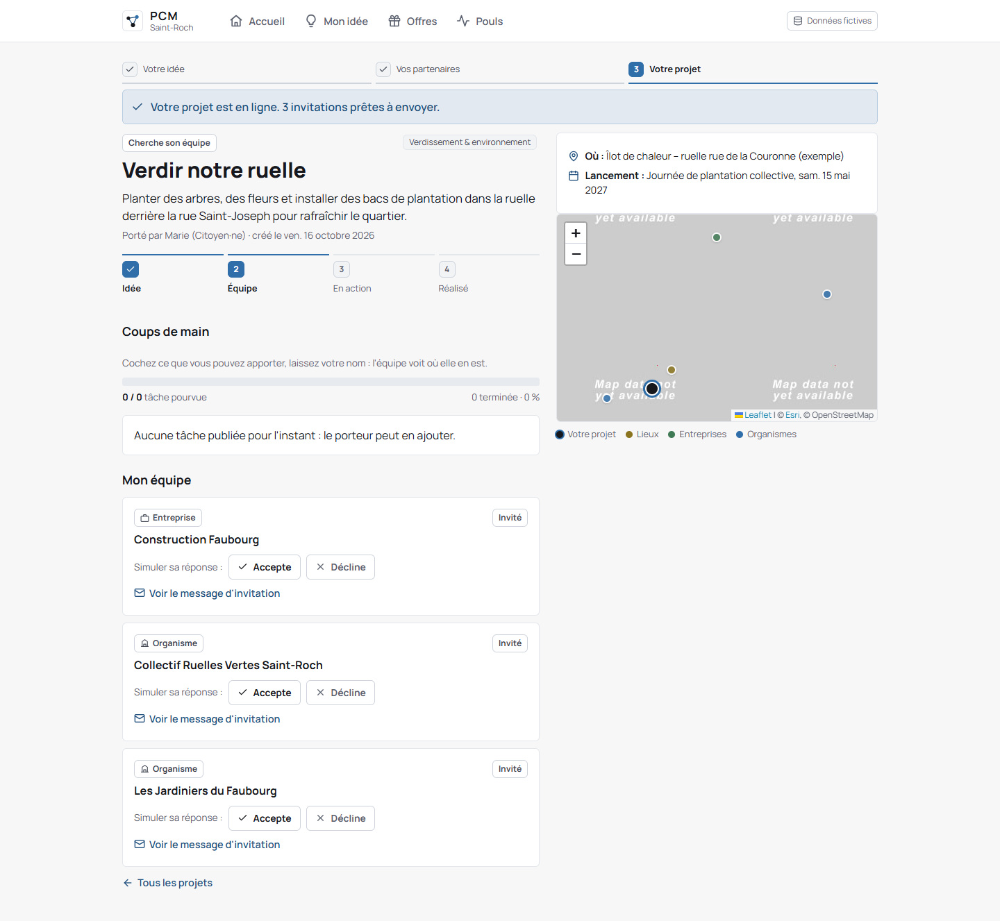 | 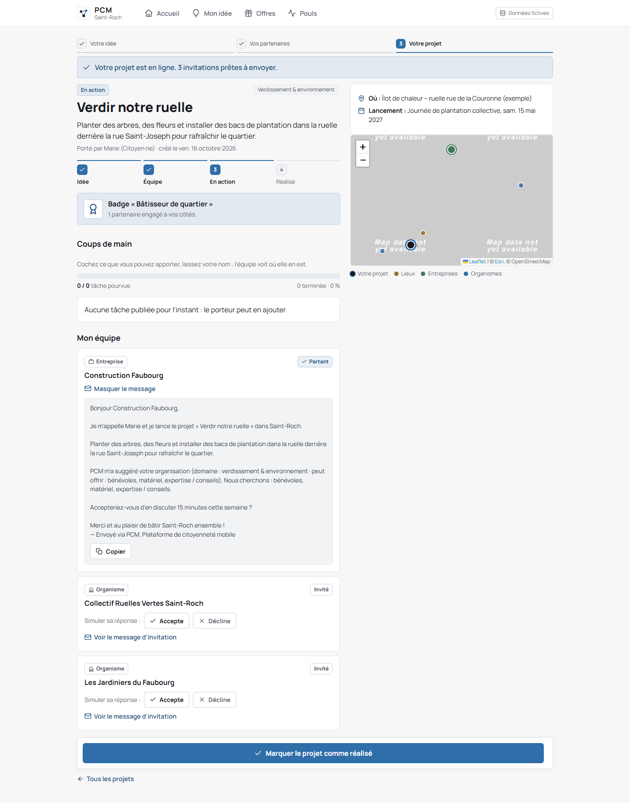 |
| **7. Coups de main & progression** | **8. Offres des partenaires (`/offres`)** | **9. Pouls du quartier (`/pouls`)** |
|  | 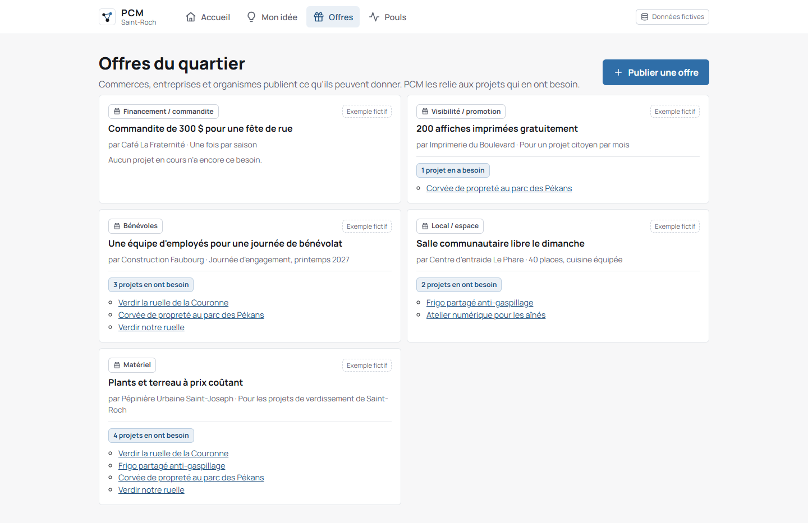 |  |

### Interface Mobile (`390×844`)

| Accueil | Dépôt d'idée | Constellation (*Qui*) | Carte (*Où*) |
| :---: | :---: | :---: | :---: |
| 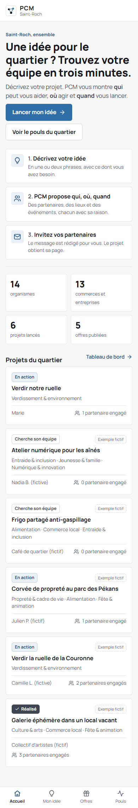 | 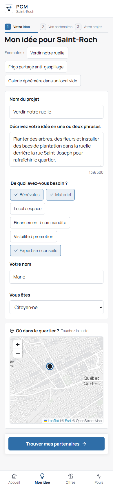 | 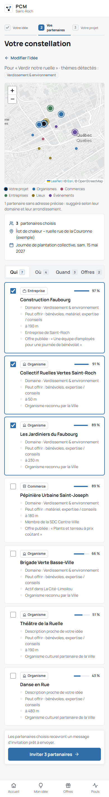 | 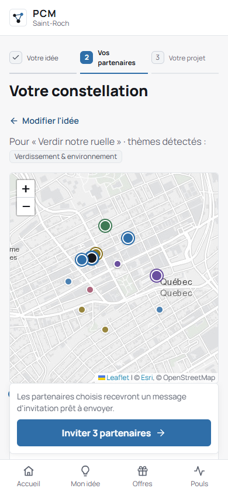 |
| **Page Projet** | **Partenaire confirmé** | **Offres** | **Pouls du quartier** |
| 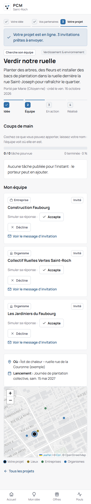 | 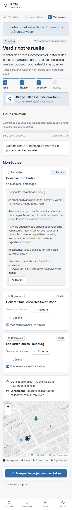 | 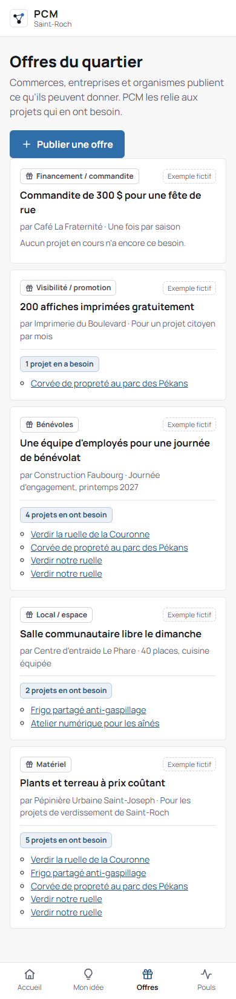 | 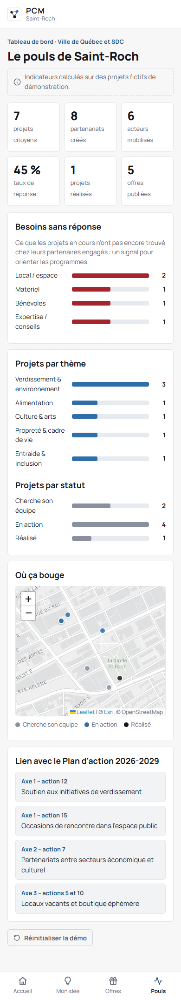 |

---

## État des fonctionnalités (Périmètre Hackathon vs Production)

Pour distinguer clairement ce qui est fonctionnel et testé dans ce dépôt de ce qui relève d'une mise en production municipale :

| Fonctionnalité | Statut | Détails techniques |
| --- | :---: | --- |
| **Moteur de suggestion tripartite (*Qui / Où / Quand*)** | ✅ Implémenté | `server/src/matching.js` — score pondéré explicable + raisons détaillées en français |
| **Recherche hybride : Lexique + TF-IDF local** | ✅ Implémenté | `server/src/themes.js` & `texte.js` — trouve des partenaires même sans mot-clé exact |
| **IA sémantique locale optionnelle (Embeddings)** | ✅ Implémenté | `server/src/embeddings.js` — modèle multilingue `paraphrase-multilingual-MiniLM-L12-v2` exécuté 100 % hors-ligne |
| **Carte interactive de Saint-Roch** | ✅ Implémenté | `client/src/components/MapView.jsx` — Leaflet + tuiles CARTO (OpenStreetMap) |
| **Espace Projet, invitations et *Coups de main*** | ✅ Implémenté | Suivi des réponses, badge *Bâtisseur de quartier*, inscription aux tâches et barre de progression |
| **Place des offres & rapprochement automatique** | ✅ Implémenté | Associe automatiquement les offres publiées aux projets ayant les mêmes besoins |
| **Tableau de bord *Pouls du quartier* (Ville / SDC)** | ✅ Implémenté | Indicateurs d'activité, besoins non comblés et alignement avec le Plan d'action 2026-2029 |
| **Pipeline d'importation des classeurs Excel de la Ville** | ✅ Implémenté | `server/scripts/import-xlsx.js` — normalise 1 696 acteurs et 41 événements localement |
| **Envoi réel des invitations (courriel / SMS)** | ⚠️ Partiel (prototype) | Le message personnalisé est généré et prêt à copier, mais l'acceptation est simulée dans l'interface |
| **Comptes utilisateurs & authentification** | 🔭 Hors périmètre 48 h | Aucune authentification dans le prototype afin de permettre un test immédiat devant le jury |
| **Base de données transactionnelle multi-instances** | 🔭 Hors périmètre 48 h | Stockage en mémoire et JSON local (`store.js`), conçu pour être remplacé par SQLite ou PostgreSQL/PostGIS |

---

## 1. Installation (5 minutes)

Prérequis : **Node.js 18 ou plus récent** (`node -v`).

```bash
git clone https://github.com/mahamoud-diabate/PCM-Connect.git
cd PCM-Connect
npm run install:all     # installe la racine, le serveur et le client
npm run dev:demo        # lance l'API (port 3001) et l'interface (port 5173) avec les données FICTIVES
```

Ouvrez ensuite **http://localhost:5173**. C'est le mode à utiliser pour présenter : il ne dépend pas des fichiers de la Ville.

**Pour tester sur un téléphone :** branchez-le au même Wi-Fi que votre ordinateur, puis ouvrez `http://<IP-de-votre-ordi>:5173` (l'adresse IP s'affiche dans le terminal, à la ligne `Network:`).

**Pour la version « production »** (un seul serveur sur le port 3001) :

```bash
npm run build && npm run start:demo
```

## 2. Scénario de démo pour le jury (2 min 30)

1. **Accueil** → « Lancer mon idée ».
2. Cliquez sur l'exemple **« Verdir notre ruelle »**, puis tapez votre nom (par exemple « Marie »).
3. « Trouver mes partenaires » ouvre **la constellation**. Montrez :
   - l'onglet **Qui** : les partenaires et les raisons de chaque suggestion (domaine, ce qu'ils peuvent offrir, distance, membre de la SDC) ;
   - l'onglet **Où** : les îlots de chaleur à verdir ;
   - l'onglet **Quand** : la Journée de plantation collective.
4. « Inviter 3 partenaires » ouvre la page du projet. Cliquez sur « Accepte » pour faire apparaître le badge **Bâtisseur de quartier**. Montrez ensuite le message d'invitation, rédigé automatiquement.
5. **Coups de main** (sur la même page) : cochez deux tâches, tapez un nom, validez — la barre passe de **33 % à 50 %** et le nom apparaît sur les tâches. Montrez « Marquer terminée » sur une tâche.
6. **Offres** : montrez que les offres des partenaires sont reliées automatiquement aux projets qui en ont besoin.
7. **Pouls** : le tableau de bord de la Ville et de la SDC (besoins sans réponse, lien avec le Plan d'action 2026-2029).

Pour rejouer la démo à l'identique : bouton **« Réinitialiser la démo »** en bas de l'écran Pouls (ou `npm run reinitialiser` dans `server/`). Le jeu de démonstration est régénéré au démarrage suivant.

## 3. Brancher les vraies données (EN LOCAL UNIQUEMENT)

⚠️ **Entente de confidentialité** : les fichiers fournis par la Ville ne doivent pas être envoyés à un outil d'IA externe, et ne doivent pas être versionnés. Tout le traitement se fait **sur cette machine**.

1. Créez un dossier `donnees/` à la racine de `pcm/` et copiez-y les 4 fichiers Excel. Ce dossier est **exclu de Git**.
2. Ouvrez `server/scripts/import-config.json` et vérifiez **les chemins des fichiers** et **le nom exact des colonnes** (la première ligne de chaque fichier Excel).
3. Lancez :
   ```bash
   cd server
   npm run import
   ```
   Le script affiche les colonnes qu'il trouve dans chaque fichier, ce qui aide à corriger la configuration. Il écrit `server/data/local/partners.json` et `server/data/local/events.json` — un dossier **exclu de Git**.
4. **Coordonnées (optionnel)** : `npm run geocode` ajoute la latitude et la longitude à partir des adresses, via Nominatim (OpenStreetMap). Ce service est **externe** : vérifiez avec les organisateurs que c'est permis avant de l'utiliser. Sans coordonnées, la correspondance se fait par domaine, par catégorie et par arrondissement.

Pour revenir au jeu fictif à tout moment : supprimez le dossier `server/data/local/`, ou lancez `npm run dev:demo`.
Les lieux d'exemple (parcs, îlots de chaleur) se mettent dans `server/data/places.json`.

## 4. Le moteur de suggestion

Fichiers : `server/src/matching.js`, `server/src/texte.js`, `server/src/themes.js`

```
score = 0,55 × pertinence thématique + 0,25 × besoins couverts + 0,20 × proximité
```

- **Pertinence thématique**, trois signaux locaux, le meilleur des trois l'emporte :
  1. un lexique de 10 thèmes (`server/src/themes.js`) comprend une idée écrite en langage courant ;
  2. **TF-IDF** sur les fiches des partenaires (`server/src/texte.js`) : une idée qui n'emploie aucun mot-clé du lexique trouve quand même le bon partenaire si les textes se ressemblent (test : « tournoi d'échecs » rejoint l'organisme qui s'occupe des aînés) ;
  3. une **IA sémantique locale** optionnelle (voir plus bas).
- **Besoins couverts** : ce que le partenaire peut offrir, d'après son type ou ses offres publiées.
- **Proximité** : distance à vol d'oiseau (Haversine). Le score est 1 sur place et 0 au-delà de 1,5 km. Un partenaire sans adresse est situé par son arrondissement, jamais par un score inventé.

**Fond de carte** : les tuiles viennent de CARTO (données OpenStreetMap) et non du serveur public `tile.openstreetmap.org`, qui bloque les applications trop demandeuses (erreur 403 « Access blocked »). Si la carte apparaît grise, c'est que la connexion Internet est coupée : les points et les fiches restent affichés.

### IA sémantique locale (optionnelle)

```bash
cd server
npm i @xenova/transformers
USE_EMBEDDINGS=1 npm run dev:demo      # Windows PowerShell : $env:USE_EMBEDDINGS=1; npm run dev:demo
```

Cette option charge le modèle multilingue `paraphrase-multilingual-MiniLM-L12-v2`, qui **tourne sur la machine**. Le modèle est téléchargé une seule fois, puis aucune donnée ne sort de l'ordinateur. Un repère « IA locale » s'affiche alors dans la constellation.

## 5. Structure

```
PCM-Connect/
├── client/                        React + Vite (installable sur mobile)
│   └── src/
│       ├── pages/                 Accueil, Idee, Constellation, Projet, Offres, Pouls
│       ├── components/            MapView (Leaflet / OpenStreetMap), Icone, Ui
│       ├── api.js                 appels à l'API, libellés français
│       └── styles.css             thème clair, une seule police (Manrope), coins de 6 px
└── server/                        Node.js + Express
    ├── src/
    │   ├── index.js               routes /api/*, validation des entrées
    │   ├── matching.js            moteur QUI / OÙ / QUAND
    │   ├── themes.js              lexique thématique
    │   ├── texte.js               TF-IDF local
    │   ├── graines.js             jeu de démonstration FICTIF, régénéré à la demande
    │   ├── embeddings.js          IA locale optionnelle
    │   └── store.js               données en mémoire, état dans data/runtime.json
    ├── data/
    │   ├── demo/                  données FICTIVES versionnées
    │   ├── local/                 données de la Ville (exclu de Git)
    │   ├── places.json            lieux d'exemple
    │   └── runtime.json           projets et offres créés (exclu de Git)
    ├── test/moteur.test.js        7 tests du moteur et de l'API (npm test)
    └── scripts/                   import Excel, géocodage, réinitialisation
```

### API

| Méthode | Route | Rôle |
|---|---|---|
| GET | `/api/meta` | thèmes, besoins, source des données, statistiques |
| GET | `/api/partners?q=` | recherche d'organisations (30 résultats maximum) |
| POST | `/api/match` | `{titre, description, besoins[], lat, lng}` → `{qui, ou, quand, offres}` |
| GET / POST | `/api/projects` | lister ou créer des projets (avec les partenaires invités) |
| PATCH | `/api/projects/:id/equipe/:partnerId` | réponse d'un partenaire (`invite`, `accepte` ou `decline`) |
| PATCH | `/api/projects/:id` | changer le statut d'un projet (`recherche`, `en_cours`, `realise`) |
| POST | `/api/projects/:id/taches` | ajouter un coup de main à pourvoir (libellé, besoin, nombre de places) |
| POST | `/api/projects/:id/contribuer` | s'inscrire à une ou plusieurs tâches (nom, type, tâches cochées) |
| PATCH | `/api/projects/:id/taches/:tacheId` | marquer un coup de main comme terminé (ou le remettre à faire) |
| GET / POST | `/api/offers` | offres des partenaires, avec les projets correspondants |
| GET | `/api/dashboard` | indicateurs du tableau de bord Ville / SDC |
| POST | `/api/reset` | régénérer le jeu de démonstration |

## 6. Données et confidentialité

- Deux jeux de données séparés : `data/demo/` (fictif, versionné) et `data/local/` (la Ville, **exclu de Git** — voir `.gitignore`).
- L'interface indique toujours la source : « Données de la Ville · locales » ou « Données fictives ».
- Les projets et les offres de démonstration portent `demo: true` et s'affichent avec la marque **« Exemple fictif »**.
- Le script de géocodage est le seul à sortir de la machine : il envoie des adresses à Nominatim et le dit dans son en-tête.
- L'API n'a pas d'authentification : c'est un prototype de démonstration, à faire évoluer avant toute mise en ligne (comptes partenaires, clé d'API, limitation de débit).

## 7. Vérifications faites

| Commande | Résultat obtenu |
|---|---|
| `npm test` (dans `server/`) | 7 tests verts : moteur, TF-IDF, jeu de démonstration, coups de main (inscription, progression, doublons), validation de l'API |
| `npm run build` (dans `client/`) | build de production réussi |
| Parcours complet dans Chrome (sans interface) | accueil → idée → constellation → invitation → projet → coups de main → offres → pouls, **0 erreur JS** ; barre de progression mesurée à 301 px sur 601 px après inscription (33 % → 50 %) |
| Contrôle des contrastes WCAG | tous les textes ≥ 4,5:1 sur leur fond |
| `npm run import` puis démarrage | 1 696 partenaires, 41 événements, toute la chaîne sur les données réelles |

## 8. Pistes d'évolution (pour le pitch)

- Des comptes partenaires, pour que chacun mette sa fiche à jour, et des notifications par courriel ou SMS.
- Un module **Vitrines vivantes** : les locaux vacants deviennent des offres, au service des actions 5 et 10 de l'axe 3.
- L'intégration au futur quartier universitaire de l'UQ (projets étudiants).
- L'extension aux 9 artères commerciales des SDC de Québec.

## 9. Licence

Distribué sous licence [MIT](LICENSE).

---
*Les données de démonstration sont fictives. Les noms d'organismes et de commerces sont inventés. Ce prototype a été codé avec une forte assistance IA : c'est assumé, et ce README distingue ce qui est vérifié de ce qui ne l'est pas.*
