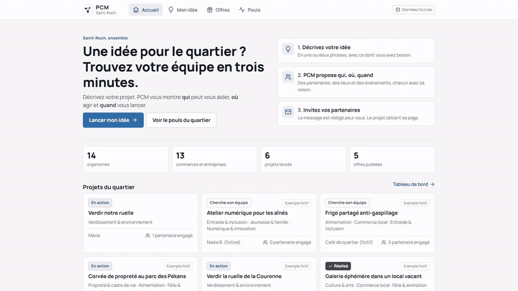
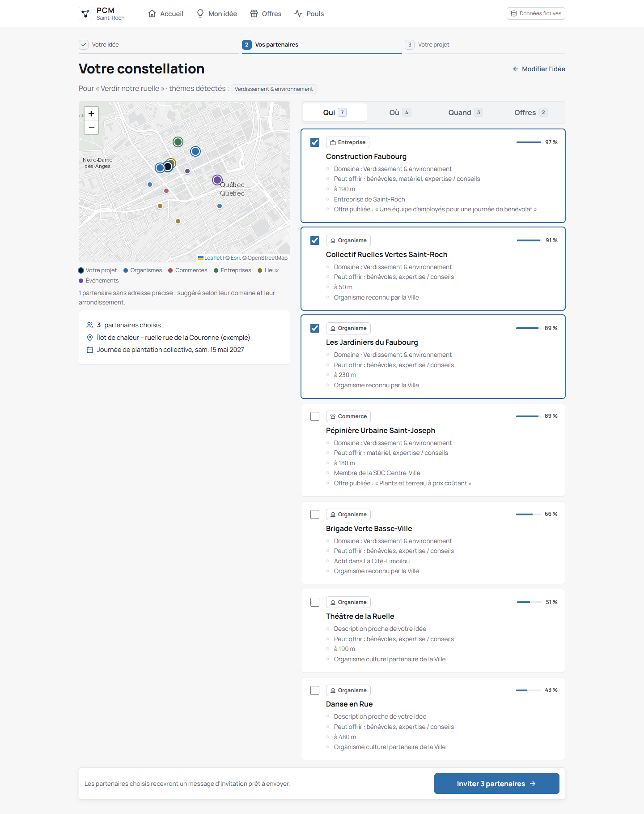
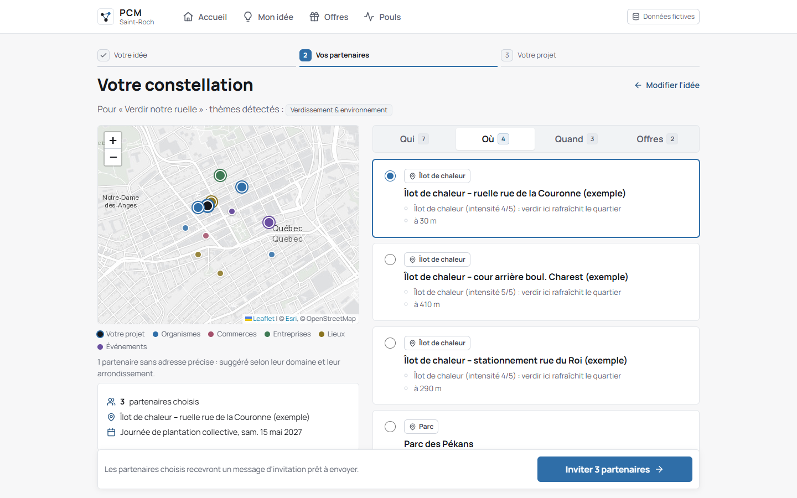
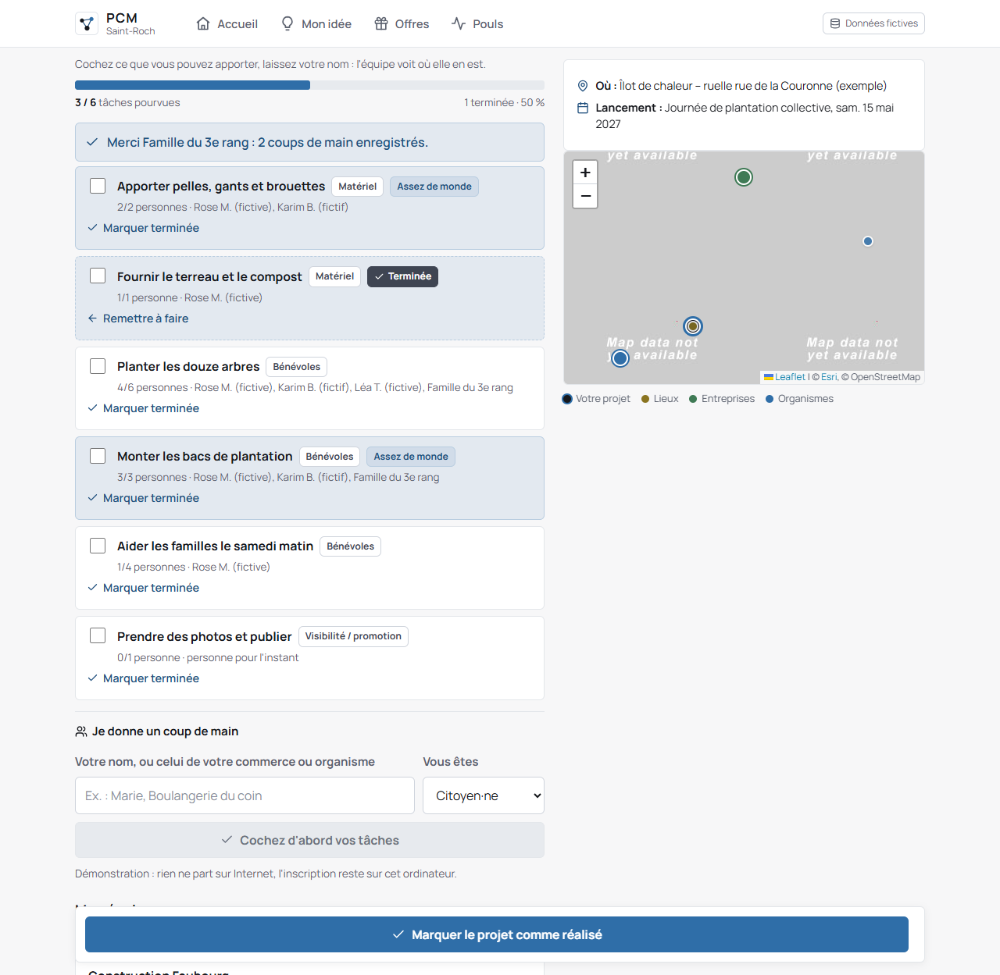
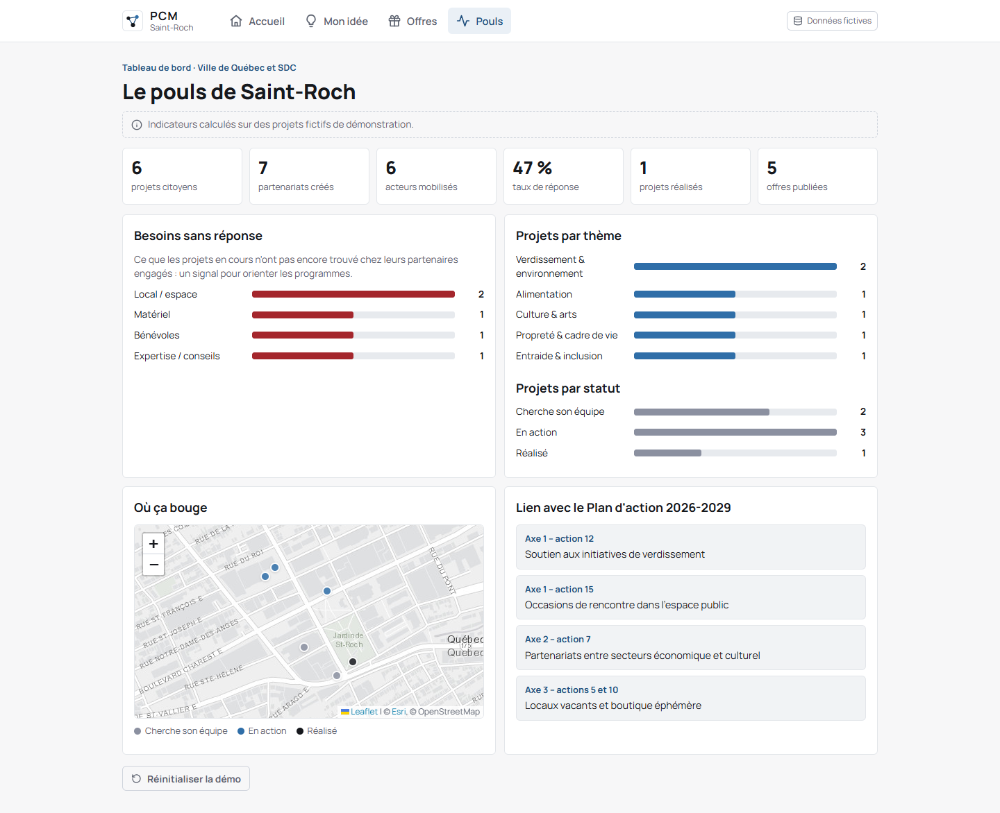

# PCM · Hackathon Saint-Roch 2026

[](https://github.com/mahamoud-diabate/PCM-Connect/actions/workflows/ci.yml)

Plateforme citoyenne de mobilisation, prototype construit en 48 h à l'occasion du **Hackathon Saint-Roch 2026** (Ville de Québec), en équipe de trois. Le défi : faciliter la création de projets dans le quartier Saint-Roch en mobilisant les résidents, les commerçants et les organismes locaux.

Le projet n'a pas gagné, mais le prototype complet (React + Express) fonctionne et se teste avec un jeu de données fictif.



Vidéo complète : [`docs/demo-parcours.mp4`](docs/demo-parcours.mp4). Diapos du pitch : [`docs/presentation/PCM-presentation-jury.pdf`](docs/presentation/PCM-presentation-jury.pdf).

## Ce que fait l'application

Le 311 sert à signaler un problème à la Ville, mais il n'existe rien de simple quand un résident ou un commerçant veut monter un projet de quartier (verdir une ruelle, organiser un atelier, partager un local) et cherche à qui parler.

À partir d'une idée écrite en quelques lignes, PCM propose trois choses :

- **Qui contacter** : les organismes, commerces et entreprises qui correspondent au besoin, avec la raison affichée (domaine, local ou matériel disponible, distance à pied, membre SDC).
- **Où agir** : les lieux du quartier (îlots de chaleur, parcs, placettes) sur une carte Leaflet.
- **Quand lancer** : les événements à venir auxquels se greffer.

Une fois le projet créé, la page permet de générer les messages d'invitation, de cocher des **coups de main** (petites tâches ouvertes aux voisins, sans création de compte) et de suivre les besoins non comblés côté Ville et SDC dans l'onglet **Pouls**.

| Constellation (partenaires) | Carte (lieux) |
| :---: | :---: |
|  |  |
| **Page projet et coups de main** | **Pouls** |
|  |  |

## Lancer en local

Prérequis : Node.js 18+.

```bash
git clone https://github.com/mahamoud-diabate/PCM-Connect.git
cd PCM-Connect
npm run install:all
npm run dev:demo
```

Interface sur `http://localhost:5173`, API sur le port `3001`. Les tests : `npm test`.

## Comment le matching calcule ses suggestions

Le code est dans `server/src/matching.js` et `server/src/texte.js` :

```text
score = 0.55 * pertinence_thematique + 0.25 * besoins_couverts + 0.20 * proximite
```

La pertinence combine un lexique de 10 thèmes (`themes.js`) et un TF-IDF local (`texte.js`) sur les descriptions des organismes, pour trouver une correspondance même sans mot-clé exact. Un mode optionnel (`USE_EMBEDDINGS=1`) charge un modèle d'embeddings local via `@xenova/transformers`. Les besoins cochés sont comparés aux ressources offertes par chaque partenaire, et la proximité est une distance Haversine (1 sur place, 0 au-delà de 1,5 km).

## Données et limites

Pendant le hackathon, le moteur tournait sur 4 fichiers Excel fournis par la Ville de Québec : 1 696 partenaires et 41 événements. Ces fichiers ne sont pas dans le dépôt (`donnees/` et `server/data/local/` sont dans `.gitignore`, à cause de l'entente de confidentialité). Le dépôt public utilise le jeu fictif de `server/data/demo/`. Pour importer les vrais fichiers en local, les placer dans `donnees/` puis lancer `npm --prefix server run import`.

Ce qui manque encore : pas d'authentification, stockage en mémoire et en JSON (`server/src/store.js`), et pas d'envoi réel de courriels ou de SMS. Les invitations et les réponses des partenaires sont simulées dans l'interface.

## Structure

- `client/` : React 18, Vite, React Router, Leaflet
- `server/` : Node.js, Express, moteur de matching, import Excel, tests
- `docs/` : captures d'écran, vidéo, présentation PDF

## Licence

[MIT](LICENSE)
